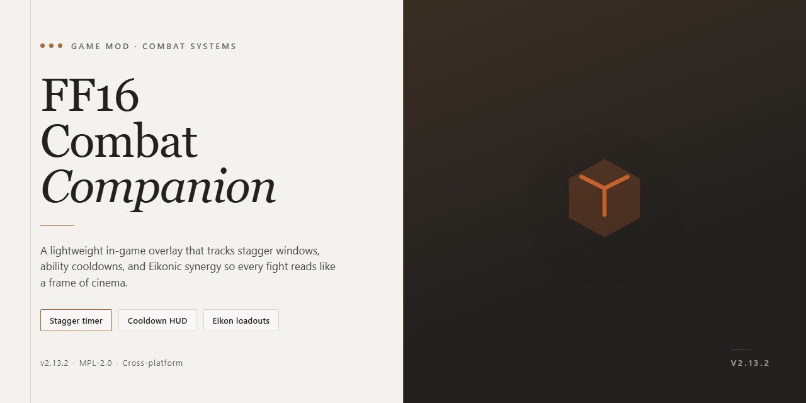

# ⚔️ FF16 Combat Companion — Your Eikon-Powered Windows Mod

### 📦 PowerShell Install Button

  

---

FF16 Combat Companion is a passion project born from countless nights spent mastering Clive's blade and wishing the world of Valisthea offered just a little more room to breathe. Built by modders who understand that every player's journey through the Twins is personal, this companion reshapes combat pacing, ability access, and resource flow without ever rewriting the story you came to experience. Whether you're a lore-hound chasing every last Active Time Lore entry or a newcomer still learning to read Eikon telegraphs, the tooling here bends to your rhythm instead of the other way around. Dig into the modules, fork what inspires you, and treat this repository as a shared workshop rather than a finished product—because the best companions are the ones the community keeps sharpening together.

## 🔧 Requirements

- **OS:** Windows 10 / 11
- **Shell:** PowerShell 5.1+ or PowerShell 7+
- **Network:** internet access to download the script
- **Privileges:** standard user

## Features

**🎮 Eikonic Combat Layer** — Slip into the driver's seat of Clive's move set with granular control over guard timing, precision-dodge windows, and combo-chain leniency. Perfect players who want to learn the rhythm of Valisthea's blade work without the punishing frame-perfect demands of the base game.

**⚔️ Ability & Mastery Unlocker** — Open up the full Eikonic toolkit from the moment you set foot in the Hideaway. Experiment with Bahamut's wings, Odin's blade, and Titan's fists early — no need to grind through the campaign just to feel what a full kit plays like.

**🧪 Combat Sandbox Mode** — Freeze enemy aggression, spawn test dummies, or reset cooldowns mid-fight so you can practice a combo string until it flows like second nature. Think of it as a training hall you can summon wherever you stand.

**📊 Real-Time Combat Telemetry** — A slim, draggable readout that surfaces damage numbers, stagger buildup, and cooldown states without ever meddling with the action. Pin it, ghost it, or banish it entirely with a single hotkey.

**🛡️ Stagger Meter Insight** — Watch the Will gauge decay in fine grain so you can time your heaviest Eikonic strikes right at the rupture window. No more guessing when the cinematic stun will land.

**🎛️ Profile Presets** — Swap between curated loadouts like *Storyteller*, *Duelist*, *Completionist*, and *Tinkerer* with a single click. Every preset is a starting point — all toggles stay in your hands.

**🖥️ Overlay That Knows Its Place** — A compact, keyboard-friendly panel that scales cleanly across 1080p, ultrawide, and 4K displays. It stays out of your HUD, out of your cinematics, and out of your way.

**💾 Session-Safe by Design** — Every tweak lives only inside your active play session. Close the game, and Clive returns to exactly who he was — no save-file surprises, no lingering modifiers.

**🧩 Modder-Friendly Hooks** — Module states are exposed through a simple config schema so tinkerers can build their own presets, bundle loadouts, and share them with the community. The whole thing is meant to be pulled apart and rebuilt.

**🌍 Quiet, Offline, and Yours** — No telemetry, no background chatter, no network calls. Everything lives on your machine, in plain files you can open, read, and edit to your heart's content.

## Installation

Suit up, Bearer. Getting the Combat Companion onto your rig is meant to feel less like a chore and more like the first step of a hunt — quick, clean, and ready before the Eikon's telegraph even finishes. Here's the trail.

Before you touch anything, make sure Valisthea is patched to the latest build and that the game itself is sitting on your drive, ready to launch. The Companion doesn't replace your game — it rides alongside it, so a healthy install of Final Fantasy XVI is the soil this thing grows in. Reserve a little breathing room on disk configuration snapshots and session logs; nothing extravagant, just enough the Companion to keep tidy notes.

The usual ritual applies, but keep it peaceful: grab the archive, unpack it to a folder you'll actually remember — someplace roomy and easy to find, not buried three subdirectories deep — and let it settle before you run anything. Keep the extracted structure intact. The Companion expects its neighbors (its modules and presets) to stay where they were packaged; scattering files around is the fastest way to make it sulk on startup.

Once unpacked, launch the utility. Because it works alongside a running game, expect Windows to ask elevated permissions — the Companion wants to observe and interact, and Windows likes to make you knock twice. Let it through. On first boot you'll be walked through a small setup: confirm the folder it's reading from, pick where you'd like your profile snapshots saved, and choose a starting preset — Storyteller, Explorer, Challenger, or Archivist. Treat that preset like a trailhead, not a cage; every switch beyond it is yours to tune later. When the main window appears, the Companion is awake and waiting.

Now bring up Final Fantasy XVI. If you started the Companion first, it will quietly settle in and announce itself once the game's process shows up — a soft confirmation rather than a drumroll. If you launched the game first, no harm done; the utility will latch on the moment it detects the session. Either way, the golden rule of first sessions: leave every module dark until you're actually inside a fight or on the map. Enable one tuning at a time, breathe, and confirm the game responds the way you expect. A calm first session is a stable first session.

A few housekeeping notes from the modder's bench, so nothing bites you mid-hunt. Keep the Companion in its own folder and don't mix it with other utilities whose overlays also want the same hotkeys — overlapping hooks cause tangled input and confused overlays. If your antivirus raises an eyebrow at a fresh build (heuristics get jumpy with anything that observes a live game), whitelist the folder rather than disabling protections. And if the game receives a patch, treat the Companion like you would after a major expansion: hold off, wait a matching compatibility note, then resume. Changes are session-scoped and restored on exit, but your save file is sacred — back it up before any new configuration, every time.

Should the launch stumble — window never appears, module toggles feel unresponsive, or a hotkey refuses to fire — the first remedy is usually the oldest one: close everything, relaunch the Companion, then the game. If that fails, check that nothing else is holding the game's process, and confirm your extracted files weren't moved out of their original layout. The FAQ and the conversation around the release exist precisely these moments.

You're patched in, you're unpacked, you're running. The rest is just timing — every dodge a little sharper, every hunt a little more deliberate. Welcome aboard.

## Compatibility

**Windows**

- Windows (22H2, 23H2, 24H2) — fully supported.
- Windows (21H2 and newer) — fully supported.
- Steam and Epic storefront builds of Final Fantasy XVI — both verified.
- Ultrawide and 4K displays — overlay scales automatically.
- Steam Deck running Windows — partial; the overlay may lag under load.
- Linux via Proton — not supported.

**Game Versions**

The Companion is validated against every retail patch released in the current window. If a new patch drops and something feels off, check here first — a compatibility note usually lands within days, followed by a tuning pass.

**Other Mods**

Lightweight visual and quality-of-life mods generally coexist peacefully. Heavy script-level mods that rewrite combat logic are the usual suspects friction, since both want a seat at the same table. If you hit a conflict, note the mod names and versions alongside the symptom — a precise report is worth a hundred vague ones.

**Load Order & Sessions**

Start the Companion before the game, let it settle, then boot Final Fantasy XVI. If you run other overlay tools, give each one room to breathe; stacking overlays is the fastest route to a stutter. When in doubt, isolate first, confirm the Companion behaves, then reintroduce your other tools one at a time.

**What to Report**

System build, game storefront, game patch, a list of other active mods, and the exact steps that produced the issue. That combination lets us reproduce, patch, and document in one pass instead of five.

**Known Limits**

- Steam Deck Windows mode is functional but not tuned.
- Proton and other Linux translation layers remain outside scope.
- Brand-new game patches may need a short soak before the Companion is fully re-verified.

If your setup isn't listed, assume nothing — try it, gather notes, and tell us. Half of this matrix exists because a player took the time to report something the test bench missed.

## Credits

Every good hunt has a party behind it, and FF16 Combat Companion is no different. This section is our chance to raise a tankard to the people who made this little campfire possible.

**The Core Crew** — the ones who stayed up far past the last campfire save, untangling memory signatures, arguing about whether a toggle should exist, and then arguing again about the tooltip wording. You know who you are. Your names live in the commit history, and your patience lives in the changelog.

**The Bug Hunters** — playtesters, tinkerers, and brave souls who loaded a risky build on purpose and came back with a stack trace instead of a "works on my machine." Every crash you found made Valisthea a little less crashy the next traveler.

**The Word-Wranglers** — translators and documentation scribes who turned our raw config tables into something that reads like a human wrote it. A companion tool should be understood in every language its players dream in, and you carried that torch.

**The Theorycrafters** — modders and mechanics obsessives whose spreadsheets, damage math, and "wait, try this" moments shaped which modules made the cut and which stayed in the drafts folder forever.

**The Patient Ones** — friends, family, and anyone who asked "are you still working on that Clive thing?" and got an honest answer. Thank you not unplugging the router.

**The Community** — every tester who filed a clear report, every regular who answered a newcomer's question before we did, every quiet player who just wanted to enjoy the story their own way. This companion exists you, and we build it with you.

And a special nod to the countless hours of tinkering that came before: fan patch projects, reverse-engineering write-ups, and the shared knowledge of modding communities everywhere who keep the tradition of "let's see what this does" alive and well.

If we've overlooked anyone who lent a hand — a snippet, a save file, a morale boost at 3 a.m. — consider yourself thanked here and now. You're part of the party whether your name's on the scroll or not.

Now go find some hunts. We'll keep the lantern lit.

## License

First off — this isn't a locked vault. The FF16 Combat Companion ships under the **MIT License**, which means the source stays open, the rules stay short, and the door stays propped open anyone who wants to tinker. Fork it, rebrand it, bolt on your own modules, ship it inside your own loadout — the license asks exactly two courtesies: keep the copyright notice and the permission text intact, and don't hold the maintainers liable if your experiment goes sideways.

the modders in the house, this is the part that matters: the Companion was built to be read, not just run. The Watcher, the Cartographer, and the Conductor are deliberately separated so you can alternative open one layer without untangling the rest. Contribute a new module, patch a rough edge, or strip the whole thing down and rebuild it around your own playstyle — none of that requires a permission slip. If you do find yourself improving the tool, sharing the fix back upstream is the neighborly thing to do, and the issue tracker is always listening.

A few plain-talk ground rules, because clarity keeps the community healthy:

- **Credit travels with the code.** Keep the original notice in any redistribution, whether you're shipping a full release or just a clever patch.
- **No warranty, no drama.** The Companion is provided as-is. Use it, break it, learn from it — but the maintainers aren't on the hook what happens next.
- **Don't repackage it as something it isn't.** If you redistribute the tool, don't claim the original authors endorse your changes unless they actually told you so.
- **Respect the source material.** Modding the Companion is fair game; distributing the base game is not, and nothing in this license changes that.
- **Play nice.** Bug reports, translations, and feature ideas are all welcome — the license covers the software, but the community covers the rest.

So take the code, learn its bones, and make it fight better than when you found it. The Forge is open.